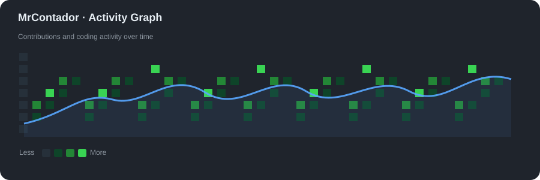
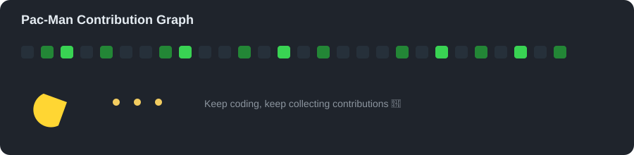

  

<h1 align="center">Olá 👋, eu sou MrContador</h1>

<h3 align="center">Desenvolvedor e criador de projetos digitais</h3>

  

  Criando soluções, explorando tecnologia e evoluindo constantemente.

<h2 align="center">🚀 Sobre mim</h2>

Tenho 24 anos e sou apaixonado por tecnologia, programação e criação de projetos.

Gosto de aprender novas ferramentas, desenvolver aplicações e transformar ideias em soluções reais.

Atualmente estou aprimorando minhas habilidades em desenvolvimento, automação, bots e projetos para a comunidade.

Meu objetivo é continuar evoluindo, criar projetos úteis e construir sistemas cada vez melhores.

 

<h2 align="center">🤝 Conecte-se comigo</h2>

  
  &nbsp;&nbsp;&nbsp;
  

<h2 align="center">💻 Tech Stack</h2>

  

<h2 align="center">📊 GitHub Stats</h2>

  

<h2 align="center">📈 Activity Graph</h2>

  

<h2 align="center">⌘ Commit Activity</h2>

  

<h2 align="center">⌘ Filosofia</h2>

  

<!-- Profile README inspirado no layout de midnightshady -->
